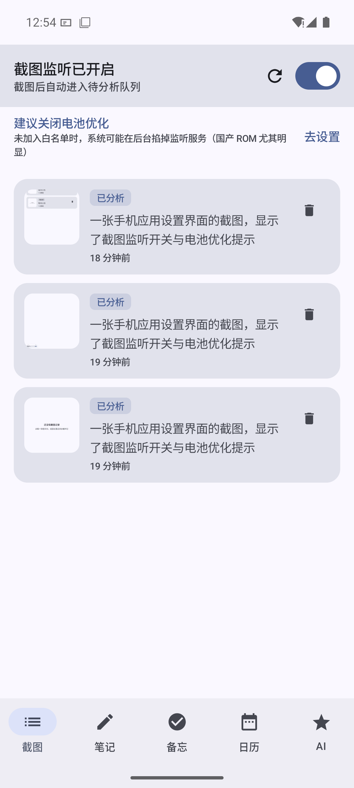
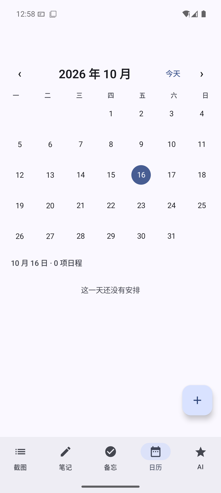
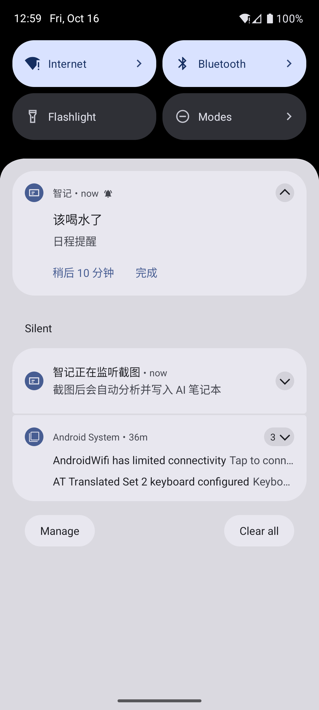
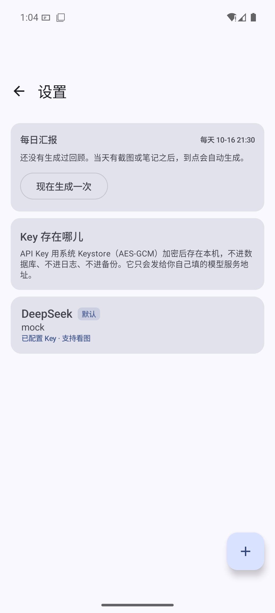

# 智记 AiNote

> 截图之后不用管，结论自己会写进 AI 分析笔记本。

一个**本地优先**的 Android AI 笔记应用。截图被系统保存的那一刻自动捕获、分析、归档；笔记、备忘、日程由同一个 AI 帮你整理；每天晚上给你一份当日回顾。

自带 API Key，可接任意 OpenAI 兼容模型 —— DeepSeek / OpenAI / 通义千问 / 智谱 / Kimi / 本地 Ollama / one-api 中转。

---

## 功能

### 截图自动分析（核心）

- **实时捕获**：`ContentObserver` 监听 MediaStore，系统截图落地即被接住
- **三层兜底**：实时监听 + 15 分钟兜底 Worker（补偿 ROM 拦截）+ 手动入口（分享菜单 / 快捷设置磁贴）
- **智能压缩**：长边压到 1024、WebP q80，一张手机截图从百 KB 降到约 10 KB
- **双通路分析**：模型支持视觉就直接发图；不支持就本地 ML Kit 中文 OCR → 纯文本模型
- **结构化落地**：解析成摘要 / 标签 / 分类 / 待办，写进「AI 截图分析」笔记本
- **去重与重试**：sha256 指纹去重；失败落库并保留原因，可一键重跑

### 笔记与备忘

- 多笔记本 + Markdown 编辑 + 700ms 防抖自动保存
- 全文搜索、置顶、软删除；空笔记自动清理
- 备忘录支持优先级、截止时间与到点提醒

### 日历与提醒

- 自绘月视图（今日高亮、事件圆点）+ 当日事件列表
- `AlarmManager` 精确闹钟，实测触发偏差 **5 毫秒**
- 通知带「稍后 10 分钟 / 完成」两个动作，不打开 App 就能处理
- 开机、改时间、换时区后自动重排（库里是唯一真相）

### AI 交互

- **全局对话**：多轮、SSE 流式输出、回车即发送
- **场景动作**：笔记里一键摘要 / 续写 / 润色 / 提取待办 —— 结果先预览，由你决定替换还是追加
- **每日汇报**：聚合当日截图 / 笔记 / 待办 / 日程，AI 写一段回顾，默认 21:30 生成
- **待办转备忘**：截图分析出的待办一键落进备忘列表

## 截图

| 截图分析笔记本 | 日历与提醒 |
|---|---|
|  |  |

| 提醒通知 | 每日汇报 |
|---|---|
|  |  |

## 快速开始

### 环境要求

| 项 | 版本 |
|---|---|
| JDK | 17 |
| Gradle | 9.6.1（wrapper 已内置） |
| AGP | 9.4.1（内置 Kotlin，**不需要** `org.jetbrains.kotlin.android` 插件） |
| compileSdk | 37（`compileSdkMinor = 2`） |
| minSdk / targetSdk | 26 / 36 |

### 构建

```bash
# Debug
./gradlew :app:assembleDebug

# Release（需要在根目录放 keystore.properties）
./gradlew :app:assembleRelease

# 单元测试
./gradlew :core:ai:testDebugUnitTest
```

`keystore.properties` 格式（该文件已被 `.gitignore` 排除）：

```properties
storeFile=keystore/your-release.jks
storePassword=****
keyAlias=****
keyPassword=****
```

没有这个文件时，Release 会自动退回 debug 签名，仍可直接构建。

### 首次使用

1. 安装后进入「截图」页，授予**相册读取权限**（否则监听不工作）
2. 建议把应用加入**电池优化白名单**（设置页有入口），否则部分 ROM 会在后台掐掉监听服务
3. 进入「AI 助手」→ 右上角设置 → `+` 选一个厂商 → 填自己的 API Key → 点「测试连接」
   - 支持看图：`qwen-vl-plus`、`glm-4v-flash`、`gpt-4o-mini`
   - 纯文本（自动走本地 OCR）：`deepseek-chat`
4. 正常截图即可，回到「截图」页能看到它进入队列并自动完成

## 技术栈

- **Kotlin** + Jetpack Compose + Material 3
- **Hilt** 依赖注入 / **Room** 12 张表 + FTS 检索 / **WorkManager** 后台任务
- **OkHttp** + kotlinx.serialization（SSE 流式手写解析，未引 Retrofit）
- **ML Kit** 中文 OCR（离线，约 +15MB）
- **Android Keystore**（AES256-GCM）加密存储 API Key
- 模块化：`app` / `core:{common,designsystem,database,data,security,ai}` / `service`

## 项目结构

```
app/                    UI 与导航（Compose）
core/common/            调度器、时间格式化、图片压缩、OCR
core/designsystem/      主题、配色、字体
core/database/          Room 12 张表 + 11 个 DAO + 种子数据
core/data/              仓库层
core/security/          Keystore 密钥保管
core/ai/                OpenAI 兼容客户端 + 截图分析 + 日报生成（含 16 个单测）
service/                前台服务、Worker、Receiver、Tile
docs/                   计划书 / 决策记录 / 验收报告
tools/                  本地 mock 服务（无 Key 时验证用）
```

## 文档

- [项目计划书](docs/PROJECT_PLAN.md) — 需求、架构、里程碑、验收标准
- [决策记录](docs/DECISIONS.md) — 12 章，记录了每个里程碑的取舍与踩过的坑
- [验收报告](docs/ACCEPTANCE_REPORT.md) — 功能矩阵、证据、未验证项清单

## 隐私

- 笔记、备忘、日程、截图副本、OCR 文本、AI 会话**全部只在本机**
- 只把「压缩后的截图（若模型支持视觉）或 OCR 文本 + 当次提示词」发给你自己配置的模型服务
- API Key 用 Android Keystore 加密存储，不进数据库、不进日志、不进备份（`allowBackup=false`）
- 说明：`network_security_config` 允许明文 HTTP，以便接入局域网自建服务（Ollama / one-api）。
  若把 Key 填给一个 `http://` 地址，Key 会以明文在链路上传输 —— 这是使用者的选择，设置页已注明。

## 已知限制

- **截图监听的 ROM 兼容性未在真机验证**：MIUI / HyperOS / ColorOS 对 MediaStore 变更通知的延迟与后台服务存活策略，模拟器复现不出来。这是最需要真机确认的一项。
- Release APK 约 44 MB，主要来自 ML Kit 中文识别模型（约 15 MB）。
- 未做云同步；全文搜索用 `LIKE`，万条以内性能正常。

## License

当前未指定开源许可证。如需公开发布，建议补充 MIT 或 Apache-2.0。
